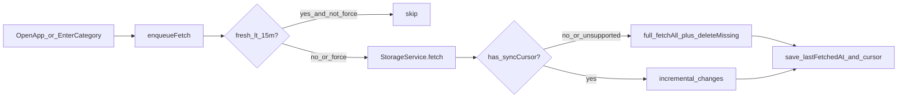

# Автосинк хранилищ (15 мин + delta)

## Решение

- Интервал: **15 минут** на storage (`force` обходит throttle — кнопка «Обновить»).
- Триггеры: **открытие приложения** + **заход в категорию хранилища** (раскрытие / уже раскрытая
  категория на экране альбомов).
- **Delta:** OneDrive `deltaLink`, Dropbox cursor, Google Drive Changes, **Nextcloud + WebDAV**
  через DAV `sync-collection` (sync-token в `syncCursor`). WebDAV при отсутствии поддержки →
  fallback на полный PROPFIND. **Yandex** — только полный `resources/files` (нормального changes
  feed нет).
- **«Обновить» ≠ полный рескан:** `force=true` только игнорирует 15 минут. Режим скана тот же: есть
  `syncCursor` → инкремент; нет курсора / Yandex / WebDAV без sync-collection → полный `fetchAll`.

## Данные

В [`Storage.kt`](app/src/main/java/com/asinosoft/photogallery/data/storage/Storage.kt) + Room
migration **8→9** в [
`AppDatabase.kt`](app/src/main/java/com/asinosoft/photogallery/data/AppDatabase.kt):

- `lastFetchedAt: Long = 0`
- `syncCursor: String? = null` (opaque: OneDrive deltaLink / Dropbox cursor / Drive
  `newStartPageToken`)

Обновлять через существующий `StorageDao.upsert` после успешного скана; при invalid token — обнулить
`syncCursor` и сделать полный проход.

## Throttle в сервисе

В [
`StorageService.kt`](app/src/main/java/com/asinosoft/photogallery/data/storage/StorageService.kt):

- `enqueueFetch(storage, force: Boolean = false)` / `fetch(..., force)`
- Если `!force` и `now - lastFetchedAt < 15 * 60_000` → no-op (лог).
- После успешного `mediaService.update(...)` записать `lastFetchedAt = now`.
- Ручной [
  `AlbumsViewModel.refreshCategoryStorage`](app/src/main/java/com/asinosoft/photogallery/model/AlbumsViewModel.kt) /
  `refreshStorage` → `force = true`.
- `addStorage` / Drive reauth `retryFetch` → `force = true`.

## Триггеры UI

1. [`MainViewModel.start()`](app/src/main/java/com/asinosoft/photogallery/model/MainViewModel.kt) —
   для каждого `storage.type != LOCAL` вызвать `enqueueFetch(force=false)` (LOCAL без изменений:
   observer + текущий fetch).
2. [`AlbumListView`](app/src/main/java/com/asinosoft/photogallery/ui/AlbumListView.kt) / [
   `AlbumsViewModel`](app/src/main/java/com/asinosoft/photogallery/model/AlbumsViewModel.kt) — при
   показе раскрытой storage-категории (`expanded || alwaysExpanded`) и при переходе в expanded:
   `enqueueFetch` этого storage с `force=false` (через `refreshCategoryStorage` с флагом или новый
   `ensureStorageFresh`).

## Контракт провайдера + MediaService

Расширить [
`StorageProvider`](app/src/main/java/com/asinosoft/photogallery/data/storage/StorageProvider.kt):

- `supportsIncrementalSync: Boolean` (default `false`)
- `suspend fun fetchChanges(cursor: String?): Flow<StorageChange>` где  
  `StorageChange = Upsert(Media) | Delete(storageItemId)`  
  и финальный курсор возвращать отдельно (например `SyncPage` / callback / `AtomicReference` на
  провайдере → `consumeNewCursor(): String?`).

Практичная схема вызова в [
`MediaService.update`](app/src/main/java/com/asinosoft/photogallery/data/MediaService.kt):

- **Full** (нет курсора или провайдер без incremental): текущий `fetchAll()` + чанки upsert + в
  конце `deleteMissing` — как сейчас; затем сохранить новый курсор (если поддерживается:
  OneDrive/Dropbox/Drive после полного прохода берут «хвостовой» cursor/deltaLink/startPageToken).
- **Incremental** (есть `syncCursor`): только `Upsert`/`Delete` из `fetchChanges`; **не** вызывать
  `deleteMissing` по всему storage; удалять точечно по `Delete`.
- Ошибка «cursor expired / 410 / reset» → clear cursor → один full retry в том же `fetch`.

Логика upsert/альбомы/thumbs для `Upsert` — переиспользовать существующий chunk-path из `update`.

## Провайдеры

| Провайдер                                                                                                                      | Поведение                                                                                                                                                                                                                                                                                                                                                                                                                                                                                                                     |
|--------------------------------------------------------------------------------------------------------------------------------|-------------------------------------------------------------------------------------------------------------------------------------------------------------------------------------------------------------------------------------------------------------------------------------------------------------------------------------------------------------------------------------------------------------------------------------------------------------------------------------------------------------------------------|
| [`OneDriveStorageProvider`](app/src/main/java/com/asinosoft/photogallery/data/storage/onedrive/OneDriveStorageProvider.kt)     | Уже бьёт `/me/drive/root/delta`. Парсить и сохранять `@odata.deltaLink`; при курсоре — GET по deltaLink; `@removed` → `Delete`.                                                                                                                                                                                                                                                                                                                                                                                               |
| [`DropboxStorageProvider`](app/src/main/java/com/asinosoft/photogallery/data/storage/dropbox/DropboxStorageProvider.kt)        | Первый проход: `list_folder` recursive → сохранить cursor. Далее: `list_folder/continue`; `tag=deleted` → `Delete`.                                                                                                                                                                                                                                                                                                                                                                                                           |
| [`GoogleDriveStorageProvider`](app/src/main/java/com/asinosoft/photogallery/data/storage/gdrive/GoogleDriveStorageProvider.kt) | Full: текущий files.list + в конце `changes.getStartPageToken`. Incremental: `changes.list` → upsert файлов / delete removed.                                                                                                                                                                                                                                                                                                                                                                                                 |
| [`NextCloudStorageProvider`](app/src/main/java/com/asinosoft/photogallery/data/storage/nextcloud/NextCloudStorageProvider.kt)  | DAV `**sync-collection**` (RFC 6578): первый проход с пустым sync-token → полный снимок + token; далее только изменения; `404` sync-token → reset + full. Sardine может не покрывать REPORT — raw OkHttp PROPFIND/REPORT при необходимости.                                                                                                                                                                                                                                                                                   |
| [`WebDavStorageProvider`](app/src/main/java/com/asinosoft/photogallery/data/storage/webdav/WebDavStorageProvider.kt)           | То же `sync-collection`, если сервер отвечает; иначе `**supportsIncrementalSync` фактически false** и полный обход папок как сейчас. Ошибка/501 → clear cursor, full fallback, больше не долбить sync до следующего force/успеха (или retry sync раз в сессию — зафиксировать: при 501 ставить флаг «no sync» на время процесса или просто каждый раз пробовать sync и быстро падать в full). Практично: один probe, при fail — full + `syncCursor=null`, следующий автоскан снова full пока сервер не начнёт отдавать token. |
| [`YandexStorageProvider`](app/src/main/java/com/asinosoft/photogallery/data/storage/yandex/YandexStorageProvider.kt)           | Без delta: полный `resources/files` + `deleteMissing`; только throttle 15 мин.                                                                                                                                                                                                                                                                                                                                                                                                                                                |

Общий helper для Nextcloud/WebDAV (например `DavSyncCollection`) — один XML REPORT/парсер sync-token
и `404`/deleted href, чтобы не дублировать.

## Вне скоупа

- Периодический WorkManager в фоне.
- Pull-to-refresh UI.
- Мягкая догрузка Yandex через `last-uploaded` (дыры по удалениям).